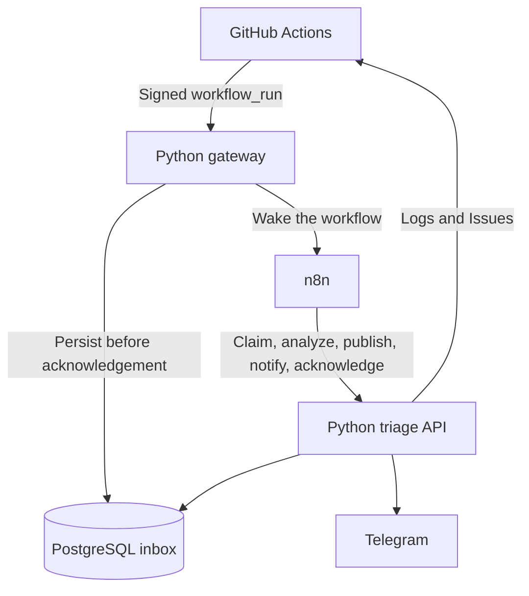

# n8n CI Triage

An evidence-first assistant for GitHub Actions failures. n8n coordinates a durable
Python pipeline that reads failed job logs, classifies a small set of known errors,
groups repeat failures into GitHub Issues, and optionally sends Telegram notifications.

**Status: initial implementation.** The default configuration is a local, account-free
demo. GitHub writes and Telegram delivery require explicit configuration. No LLM or
paid AI API is needed.

## What it demonstrates

- HMAC-SHA256 verification over the original GitHub request bytes.
- A PostgreSQL inbox with delivery and `(repository, run ID, attempt)` deduplication.
- Leases, bounded retries, a dead-letter state, and manual replay.
- Attempt-specific job lookup, paginated GitHub requests, and bounded log retention.
- Rule-based evidence extraction for dependency, test, lint, build, and unknown errors.
- Incident grouping scoped to repository, workflow, branch, job, and normalized evidence.
- Marker-based reconciliation of GitHub Issues and occurrence comments after retries.
- Ordered recovery tracking; stale successes cannot resolve newer failures.
- A nine-node n8n workflow with webhook, manual, and recovery triggers.
- Optional Telegram notifications and saved drafts when external delivery is disabled.

## Architecture



n8n owns orchestration and retries between stages. Python owns signature verification,
log parsing, incident identity, and persistence. Only Python receives the GitHub and
Telegram tokens. The workflow contains a credential reference, never a secret value.

## Run the Docker demo

Requirements: Docker Engine with Compose, Python 3.12+, and an available local port
`5678` and `8000`. The Docker image installs Python dependencies using `uv` and `uv.lock`.

```bash
git clone https://github.com/aboumelon/n8n-ci-triage.git
cd n8n-ci-triage
python3 scripts/configure.py
docker compose up -d --build
```

1. Open `http://localhost:5678` and create the n8n owner account.
2. Run `python3 scripts/bootstrap_n8n.py` to import the workflow and its generated
   internal header credential. It is intended for a fresh n8n instance: the IDs belong
   to this project and an existing workflow with the same ID would be overwritten.
3. Open **CI Triage**, inspect the nodes, and **Publish** it.
4. Send a deterministic demonstration event:

```bash
python3 scripts/send_demo.py dependency --delivery demo-001
python3 scripts/inspect_runs.py
```

The report should contain category `dependency` and evidence
`ModuleNotFoundError: No module named 'httpx'`. Publication and Telegram are saved as
drafts. Wait for the n8n execution to finish before inspecting the report.

If CLI import is unavailable, import `workflows/ci-triage.json` in the editor. Create
one **Header Auth** credential named **CI Triage Internal API**, with header
`X-Triage-Key` and the `INTERNAL_API_KEY` value from your private `.env`. Assign it to
the Webhook node and the five HTTP Request nodes, then Publish.

Additional examples:

```bash
python3 scripts/send_demo.py test
python3 scripts/send_demo.py lint
python3 scripts/send_demo.py dependency --delivery demo-001
python3 scripts/send_demo.py repeat-dependency
python3 scripts/send_demo.py success
```

The repeated delivery and repeated run create no new work. `repeat-dependency` is a
different run with the same incident fingerprint. `success` records recovery for older
failures of the demo workflow on `main`. Process examples in order when demonstrating
recovery; the fixture run numbers are intentionally ordered.

## Develop with uv

```bash
python3 scripts/configure.py
uv sync --locked
N8N_DISPATCH_URL= uv run uvicorn ci_triage.api:create_app --factory --port 8000
```

This uses SQLite for local development. In another terminal:

```bash
python3 scripts/send_demo.py dependency
python3 scripts/process_once.py
python3 scripts/inspect_runs.py
```

`process_once.py` is a debugging tool that exercises the same stage API without n8n.
Normal deployment uses the published n8n workflow.

```bash
uv run ruff check .
uv run ruff format --check .
uv run pytest
```

PostgreSQL concurrency tests also run when `TEST_DATABASE_URL` points to an empty,
disposable test database. They create and remove the project's test tables. The CI
workflow supplies an isolated PostgreSQL service automatically.

## Connect a real repository

See [docs/github-and-telegram.md](docs/github-and-telegram.md). Start with:

```dotenv
TRIAGE_MODE=live
PUBLISH_MODE=draft
ALLOWED_REPOSITORIES=aboumelon/n8n-ci-triage
```

Set a GitHub token locally, configure a signed `workflow_run` repository webhook, and
verify a saved draft before setting `PUBLISH_MODE=github`. Issue publication requires
Issues write permission. The controlled **Triage demo** GitHub Actions workflow is
manual-only; it deliberately fails without breaking the project's normal CI.

## Deploy on Freestyle

Follow [docs/freestyle.md](docs/freestyle.md). The same Compose stack runs inside an
Ubuntu VM. Route two HTTPS `style.dev` names to ports `8000` and `5678`; no additional
reverse proxy or purchased domain is required for this layout.

## Delivery guarantees and limits

- A valid webhook is acknowledged after durable insertion. If the n8n wake-up fails,
  the run remains queued. The recovery trigger drains the queue once per minute while
  the VM is awake. On a sleeping VM, the next incoming webhook or manual wake-up is
  needed; the internal timer cannot wake the VM.
- Five expired processing leases move a run to `dead`. The lease defaults to ten minutes.
  `POST /internal/runs/{run_key}/retry` requeues dead-lettered work without discarding
  completed publication or notification stages.
- Database deduplication is exact. GitHub side effects use stable markers to reconcile
  ambiguous timeouts, but there is no atomic transaction shared with GitHub. Publication
  is serialized in this MVP. Do not claim distributed exactly-once delivery.
- Telegram has no send-message idempotency key. If Telegram accepts a message and the
  connection fails before acknowledgement, a retry may send a duplicate.
- Log analysis reads at most the final 1 MiB into memory per job; a `log_truncated` flag
  is included. Missing logs produce an unknown finding. A larger log still consumes
  download bandwidth. No raw job logs are stored.
- Known token formats, configured secrets, and common credential assignments are
  redacted before persistence. This does not establish that arbitrary log text is
  free of sensitive data; review drafts before enabling publication for private repos.
- Recovery is workflow-level, not proof that a particular line of code was fixed.
  `AUTO_CLOSE_ON_SUCCESS` defaults to `false`; a newer successful run adds a recovery
  comment, while a human controls issue closure.
- SQLite is for a single local development process. Use PostgreSQL for deployment.
  Schema v1 is initialized on startup; versioned migrations are a follow-up task before
  changing a deployed schema.

## Repository map

| Path | Purpose |
|---|---|
| `src/ci_triage/` | Gateway, persistence, analysis, GitHub integration, delivery |
| `workflows/ci-triage.json` | Importable n8n orchestrator, with no embedded secrets |
| `scripts/` | Secret generation, signed demos, n8n bootstrap, report inspection |
| `tests/` | Security, grouping, retry, API, integration, and queue tests |
| `deploy/` | Database initialization and Freestyle provisioning |
| `.github/workflows/` | Normal checks and opt-in failure scenarios |

Roadmap: a GitHub App installation flow, versioned migrations, richer log parsers,
metrics, and an optional evidence-constrained LLM explanation stage.
